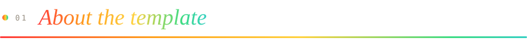
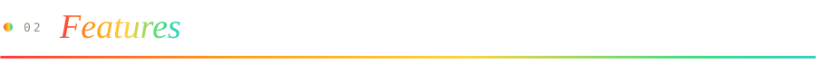
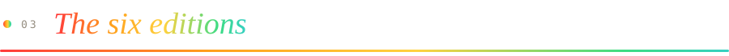
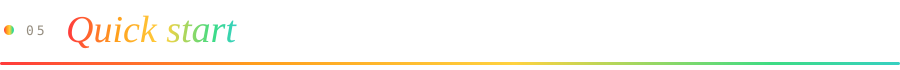
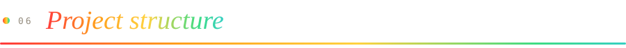
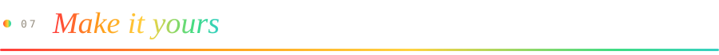

<div align="center">




<br />

<a href="#-quick-start"></a>
<a href="#-tech-stack"></a>
<a href="#-tech-stack"></a>
<a href="#-tech-stack"></a>
<a href="#-tech-stack"></a>
<a href="LICENSE"></a>

<br />

</div>


## 

**The Archive** is a portfolio template for designers and developers who want a site that feels made, not generated. It's laid out like a library catalogue: cream card stock, oxblood ink and editorial serifs. Every scroll and click is animated, and the movement is always gentle.

Visitors begin at a **rotary dial** and pick one of six _editions_ of the same portfolio. After that they come to a hero with a tilting catalogue card, then a capabilities drawer that gets a rubber stamp, work hung like gallery plates, letters from clients and a dark "reading room" to sign off.

> [!TIP]
> All of the copy lives in **one file**: `data/site.ts`. Change the words there and the whole site updates.


## 

<table>
<tr>
<td width="50%" valign="top">

**🎛️ Interaction**

- Rotary **edition dial**: drag, arrow keys, <kbd>Enter</kbd>, <kbd>R</kbd> for random
- Optional **sound** with Web Audio clicks (no audio files)
- **Custom cursor**: a dot that opens into a ring or a label
- **Magnetic** buttons and text that **rolls** on hover
- 3D **tilting card** with a moving sheen
- Folders that fan open and records that expand

</td>
<td width="50%" valign="top">

**🎞️ Motion**

- **Preloader** with a counter running from 000 to 100
- **Curtain** transitions between pages
- Headings that rise word by word (GSAP SplitText)
- Rules that draw in, numbers that count up, gentle parallax
- A rubber **stamp** that lands when you scroll to it
- Smooth scrolling with **Lenis**, paired with ScrollTrigger

</td>
</tr>
<tr>
<td valign="top">

**📱 Quality**

- Fully responsive, with a mobile "Index" menu
- Honours `prefers-reduced-motion`
- Keyboard and screen-reader friendly
- Static export: no server, no cookies, no trackers

</td>
<td valign="top">

**📄 Pages**

- Home · Biography · Résumé (prints to PDF)
- Contact form (Formspree-ready, falls back to `mailto:`)
- A case-study page for every project
- Privacy notice · a custom 404

</td>
</tr>
</table>


## 

<div align="center">

</div>

|  #  | Edition         | Mood                     | Typefaces                                                 |
| :-: | --------------- | ------------------------ | --------------------------------------------------------- |
| 01  | **The Archive** | Cream stock, oxblood ink | Cormorant Garamond · Cinzel · EB Garamond · IBM Plex Mono |
| 02  | **Midnight**    | Gold leaf on deep ink    | Bodoni Moda                                               |
| 03  | **Broadsheet**  | Hot-metal newspaper      | Anton · Source Serif 4                                    |
| 04  | **Terminal**    | Phosphor green           | JetBrains Mono                                            |
| 05  | **Blueprint**   | White line on cyanotype  | Space Grotesk                                             |
| 06  | **Atelier**     | Terracotta and sage      | Fraunces · Karla                                          |

The browser remembers each visitor's choice. Open the dial again from **Editions** in the menu or footer, or add `?editions` to the URL.


## 

<div align="center">

| Layer     | Tool                                                                       |
| --------- | -------------------------------------------------------------------------- |
| Framework | **Next.js 16** (App Router, static export) · **React 19** · **TypeScript** |
| Styling   | **CSS Modules** + CSS custom properties (one variable set per edition)     |
| Animation | **GSAP 3** with ScrollTrigger and SplitText                                |
| Scrolling | **Lenis**                                                                  |
| Fonts     | `next/font/google`, self-hosted at build time                              |
| Hosting   | GitHub Pages (workflow included) · Vercel · Netlify · any static host      |

</div>


## 

You need [Node.js 20+](https://nodejs.org/).

```bash
# 1. install
npm install

# 2. run the dev server, then open http://localhost:3000
npm run dev

# 3. production build: static files go to /out
npm run build

# 4. preview the production build
npm start
```


## 

```text
the-archive-portfolio/
├── app/                    → pages (App Router)
│   ├── layout.tsx          → fonts, metadata, edition boot script
│   ├── globals.css         → design tokens + the six editions
│   ├── page.tsx            → home
│   ├── about/  cv/  contact/  privacy/
│   └── work/[slug]/        → one case study per project
├── components/
│   ├── SiteShell.tsx       → Lenis, cursor, preloader, curtain, editions
│   ├── EditionDial.tsx     → the rotary dial
│   ├── CatalogueCard.tsx   → the tilting hero card
│   ├── Nav.tsx · Footer.tsx · ReadingRoom.tsx · Magnet.tsx · Roll.tsx
│   └── home/               → Hero, Catalogue, Work, Figures, Letters, Recognition
├── data/site.ts            → ✏️  ALL THE CONTENT
├── lib/                    → motion engine, sound, editions list, base path
├── public/images/          → portrait, desk photo, project screenshots
├── docs/readme/            → the animated SVGs used in this README
└── .github/workflows/      → automatic GitHub Pages deploy
```


## 

<details open>
<summary><b>✏️ 1. Words: <code>data/site.ts</code></b></summary>

Your name, initials, email, hero lines, capabilities, projects, figures, testimonials, recognition, biography and résumé are all plain objects. Edit them and save.

</details>

<details>
<summary><b>🖼️ 2. Pictures: <code>public/images/</code></b></summary>

| File                        | Size                    | Used for                   |
| --------------------------- | ----------------------- | -------------------------- |
| `portrait.jpg`              | 3:4 portrait, ~900×1200 | hero and biography         |
| `desk.jpg`                  | 3:2 landscape           | biography plate            |
| `work/<name>-desktop.jpg`   | 1440×920                | project plate (desktop)    |
| `work/<name>-desktop-2.jpg` | 1440×920                | shown on hover, inner page |
| `work/<name>-phone.jpg`     | 780×1688                | project plate (phone)      |

Keep the same file names, or update the paths in `data/site.ts`.

</details>

<details>
<summary><b>🎨 3. Colours and fonts: <code>app/globals.css</code></b></summary>

Each edition is a block of CSS variables (`--paper`, `--ink`, `--accent`, `--f-display` …). Change a value and the whole edition follows. To add an edition, copy a block, give it a new id, and add it to `lib/editions.ts`.

</details>

<details>
<summary><b>📬 4. Contact form: <code>components/ContactForm.tsx</code></b></summary>

Create a free form at [formspree.io](https://formspree.io) and paste its URL into `FORM_ENDPOINT`. If you leave it empty, the form opens the visitor's email app with the message filled in.

</details>

<details>
<summary><b>🚫 5. Turning things off</b></summary>

- **No dial on first visit:** in `app/layout.tsx`, delete `if(!e)d.setAttribute('data-first-visit','');`
- **No preloader:** in `components/SiteShell.tsx`, set `setNeedsLoader(false)`
- **Less motion:** visitors with _Reduce motion_ turned on already get a still site

</details>


<details>
<summary><b>Can I use it for clients?</b></summary>

Yes. It's MIT licensed. Please replace the sample person, projects and photographs first.

</details>

<details>
<summary><b>Does it need a server or a database?</b></summary>

No. `npm run build` writes plain HTML, CSS and JS to `/out`, and you can host that folder anywhere.

</details>


## 

Released under the [MIT Licence](LICENSE). The sample person, studios, quotes and photographs are fictional placeholders. Replace them with your own.

<div align="center">

<br />


<sub>Drawn by hand · built in code · if it helped you, a ⭐ is kind.</sub>

</div>


<div align="center">

## 🌟 Support the Project

If you find this template useful, please consider giving it a star! It helps others discover the repository and supports future development.

</div>
